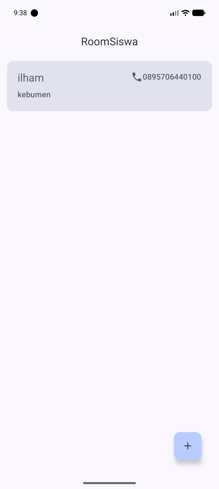
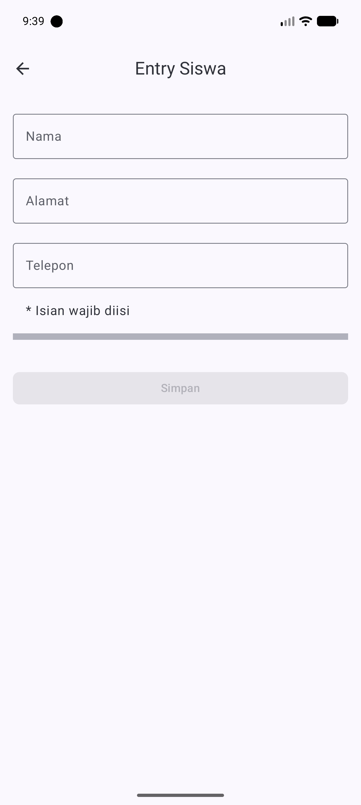
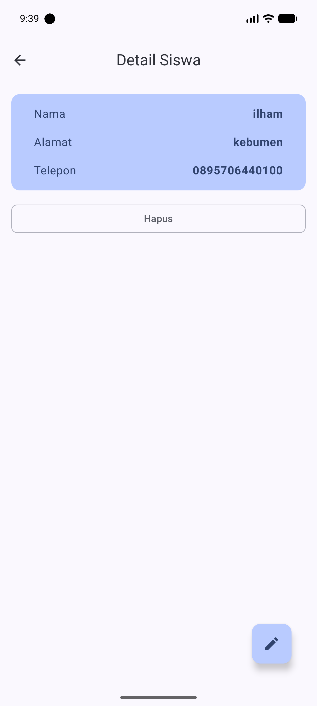
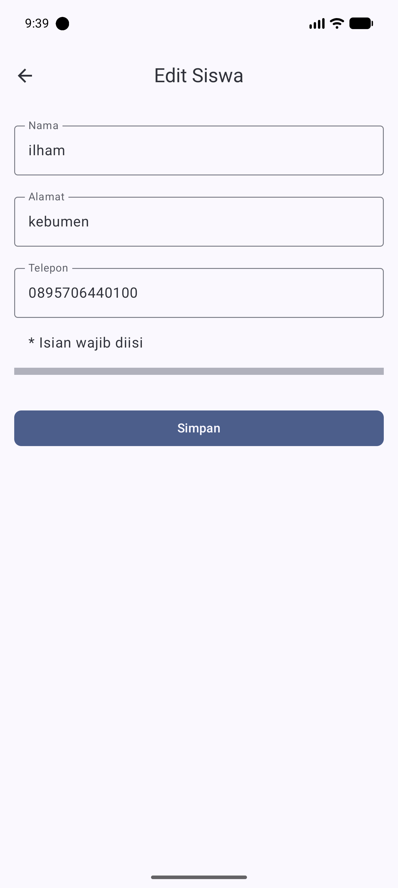

# RoomSiswa - Tugas Room Database (Praktikum 10)

Aplikasi Android sederhana untuk manajemen data siswa menggunakan Jetpack Compose, Room Database, ViewModel, dan Navigation.

## Fitur
- Menampilkan daftar siswa (Home)
- Menambah data siswa baru (Entry)
- Menampilkan detail data siswa (Detail & Hapus)
- Mengubah data siswa (Edit)

## Tangkapan Layar Hasil Running (Operasi CRUD)

### 1. Halaman Utama (Home Screen)

### 2. Halaman Tambah Data (Entry Screen)

### 3. Halaman Detail Data (Detail Screen)

### 4. Halaman Edit Data (Edit Screen)

